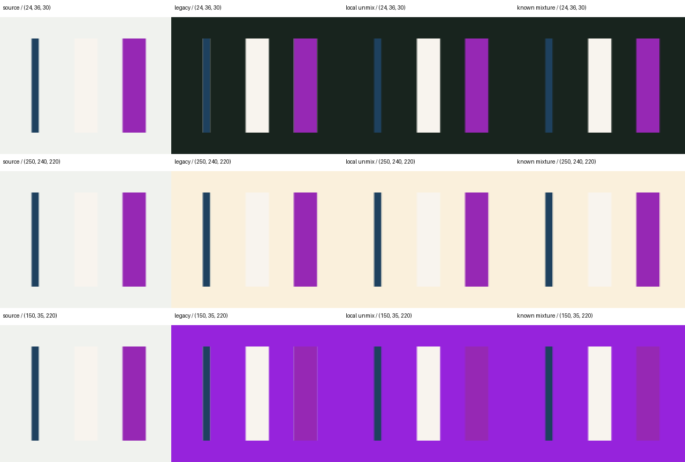

# Optional studio edge decontamination — verification, 2026-10-16

This CPU-only prototype addresses old bright-backdrop color remaining in
fractional matte pixels after masked scene recoloring. It is opt-in through
`edge_mode="local_unmix"`; the default RGB formula and receipt remain unchanged.
The [API guide](../studio-layers.md#optional-local-edge-decontamination) documents
local evidence gates, skipped edges, the reusable hash-bound evidence map and
exact browser arithmetic. No model, HTTP service or weight training is involved.

## Controlled mixture evidence

The model-free fixture contains a narrow dark line, a bright rim/petal and a
saturated strip. Each has an opaque core and one-pixel fractional edges; the
original foreground, backdrop and mixture alpha are known. For interior edge
rows, channel errors against the known recomposite are:

| Target RGB | Default maximum / mean absolute error | Local unmix maximum / mean absolute error |
| --- | ---: | ---: |
| 24, 36, 30 | 47 / 18.778 | 1 / 0.389 |
| 250, 240, 220 | 3 / 0.778 | 1 / 0.222 |
| 150, 35, 220 | 43 / 11.111 | 1 / 0.056 |

Values are display-RGB channel units (0–255), not perceptual quality scores.
The one-unit residual reflects integer source encoding. The controlled fixture
supports all 528 fractional pixels; this does not imply similar coverage on
arbitrary segmentation masks. The numerical composite is shown below at 2×
nearest-neighbor scale, with no blur or matte erosion:



Reproduce the board and a JSON receipt from the source checkout with NumPy,
Pillow, pytest and Node.js available:

```sh
python docs/testing/verify_studio_edges.py --output-dir /tmp/studio-edge-proof
```

This source-only proof imports the fixture from `tests/test_studio_edges.py`.
It independently executes the documented browser arithmetic in Node with
`Uint8ClampedArray`; all RGB pixels match Python exactly for all three targets
(**zero differing pixels**). The output directory contains the synthetic PNG
and hashes/parameters/results in `studio-edge-proof.json`. No private files,
photo identifiers, checkpoints or model downloads are used.

## Behavioral regression

Fresh focused verification: **52 tests passed**, combined module coverage
**98.95%** (`_studio_edges.py`: 100%; `studio_layers.py`: 99%).

```sh
python -m pytest tests/test_studio_edges.py tests/test_studio_layers.py \
  --cov=mlx_flash_compress.studio_layers \
  --cov=mlx_flash_compress._studio_edges \
  --cov-report=term-missing --cov-fail-under=90 -q
```

The new tests first exposed the absent `edge_mode` contract before implementation.
They cover known dark/light/saturated recomposites, source/matte immutability,
opaque scene preservation, exact zero-alpha legacy shading, neutral-reference
identity, matte-RGB independence, low-confidence enclosed transparency and
nonphysical glints, unsupported isolated fractional detail, heterogeneous local
background refusal, evidence-map hashes/geometry, invalid inputs, no-partial-edge
behavior and an independent maximum-correction refusal. Unsupported edges retain
the default result and receive explicit counters/quality flags.

The fresh full CI-style Python run passed **2216 tests and 306 subtests**, with
**19 skipped**, in **34.92 seconds**. Repository coverage was **93.86%**, above
the unchanged 90% gate:

```sh
python -m pytest tests/ -q --tb=short \
  --cov=mlx_flash_compress --cov-config=.coveragerc \
  --cov-report=term-missing --cov-fail-under=90
```

The opt-in image-model smoke was skipped because its checkpoint variable was
not set; existing optional/hardware checks retained their normal skips. This
run did not repeat inference or assess image quality. Ruff check/format and
`git diff --check` pass for the changed files; no coverage exclusion was added.

## Acceptance boundary

The actual host is an M5 Pro with 64 GiB unified memory. These CPU calculations
do not establish M4/16 GiB image-model suitability. No native image-model smoke
was run for this CPU-only change. Optional real-model/hardware checks remain
separate from model-free coverage.

The gates test color consistency, physical mixture plausibility and a nearby
opaque anchor; they do not identify material semantics or prove mask alignment.
An opaque pixel containing old backdrop color stays protected, and a fine
fractional feature without sufficient anchors stays uncorrected. Real glass
can violate the simple alpha mixture through refraction and reflections; no
glass reconstruction or guaranteed glass detection is claimed. The mode must
remain opt-in and reviewed on dark, light and saturated backdrops. Tests, hashes
and lower synthetic error are not blanket visual approval or commercial-model
parity. Every receipt retains `visual_quality_approved: false`.
